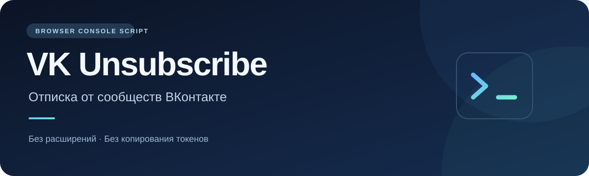

<div align="center">



# VK Unsubscribe

### Отписка от сообществ ВКонтакте через консоль браузера

Без установки расширений, копирования токенов и передачи пароля сторонним сервисам.

**[Открыть скрипт](vk-unsubscribe.js) · [Как запустить](#как-запустить) · [Как остановить](#как-остановить) · [Если возникла ошибка](#если-возникла-ошибка)**

</div>

---

> [!WARNING]
> **Скрипт предназначен для выхода из всех доступных сообществ, а не для выборочной очистки.** Он не исключает группы, которыми вы управляете. Предупреждение о выходе из закрытого сообщества подтверждается автоматически: для возвращения может потребоваться одобрение администратора, а иногда вернуться не получится.

> [!IMPORTANT]
> **Отписка от частных сообществ может не сработать.** Обработка предупреждения закрытой группы не гарантирует выход из частного сообщества. После завершения обновите страницу, проверьте оставшиеся подписки и при необходимости отпишитесь от них вручную.

## Что делает

| Действие | Как это работает |
| :--- | :--- |
| Открывает меню | Вызывает событие наведения на три точки у сообщества. |
| Отписывается | Находит в открытом меню точный пункт «Отписаться» и нажимает его. |
| Обрабатывает закрытые группы | Подтверждает только распознанное предупреждение о выходе из закрытого сообщества. |
| Проверяет интерфейс | Ждёт появления текста «Подписаться» в обработанной строке. |
| Загружает продолжение | Прокручивает страницу вниз, когда загруженные группы обработаны. |
| Показывает ход работы | Выводит названия сообществ и счётчик в консоль. |
| Останавливается при сомнениях | Прекращает работу при неизвестном диалоге, смене страницы или тайм-ауте ожидания. |

Код не читает cookies, localStorage, пароли или токены. В нём нет собственных сетевых запросов и внешних библиотек. Нажатия выполняются на странице VK; сам сайт при этом отправляет обычные запросы от вашего аккаунта.

## Перед запуском

- Используйте настольный браузер с консолью разработчика и **русский интерфейс VK**.
- Войдите в свой аккаунт обычным способом на сайте ВКонтакте.
- Убедитесь, что хотите выйти в том числе из закрытых и управляемых групп.
- Прочитайте [исходный код](vk-unsubscribe.js): любой код в консоли выполняется с доступом к странице вашего аккаунта.
- Не запускайте несколько копий скрипта и не взаимодействуйте со списком групп во время работы.

> [!IMPORTANT]
> Скрипт зависит от текущей разметки сайта. Изменения интерфейса VK могут остановить его работу. Совместимость со всеми браузерами, аккаунтами и вариантами интерфейса не гарантируется. Автоматизация может привести к капче или ограничениям аккаунта.

## Как запустить

1. Откройте **[Все сообщества](https://vk.ru/groups/my_all_groups)** и дождитесь загрузки списка.
2. Откройте файл **[vk-unsubscribe.js](vk-unsubscribe.js)** в этом репозитории и нажмите **Raw**, чтобы увидеть исходный код без оформления GitHub.
3. Скопируйте содержимое файла целиком — от `(async () => {` до последнего `})();`.
4. Вернитесь во вкладку VK. Откройте инструменты разработчика: **F12** или **Ctrl + Shift + J** в Chrome / Edge. Выберите вкладку **Console**.
5. Вставьте код и нажмите **Enter**.
6. Прочитайте окно подтверждения. Нажмите **ОК**, только если согласны выйти из всех сообществ, включая закрытые.
7. Оставьте вкладку открытой и следите за сообщениями в консоли.

Если браузер запрещает вставку кода, не отключайте защиту вслепую. Сначала убедитесь, что понимаете исходный код и последствия запуска. Проект не требует ослаблять настройки безопасности браузера.

Пример сообщений:

```text
1. Отписка: Название сообщества
2. Отписка: Другое сообщество
Интерфейс подтвердил отписок за этот запуск: 2. Обновите страницу для проверки.
```

> [!NOTE]
> Счётчик отражает изменение кнопки на странице, а не независимую проверку членства через сервер. **После завершения обновите страницу и проверьте список.** Если новые группы не загрузились за несколько попыток прокрутки, скрипт завершится — это не доказательство, что список полностью пуст.

## Как остановить

Введите в консоль во время работы:

```js
vkLeaveAll.stop = true
```

Скрипт остановится при ближайшей проверке. Уже отправленное действие не отменяется. Другой способ — **обновить или закрыть вкладку**. Выполненные отписки не восстанавливаются.

Если после завершения появилась ошибка `vkLeaveAll is not defined`, значит рабочее состояние уже удалено и этот запуск завершён.

## Скорость работы

В конце цикла в файле находится пауза:

```js
await sleep(700);
```

Это **700 миллисекунд между обработками**. Дополнительно скрипт ждёт меню, изменения кнопки и загрузки списка, поэтому фактическое время больше. Для более медленного темпа замените `700` на `1500` или `2000` перед запуском. Уменьшение паузы не гарантирует ускорения и может вызвать ограничения VK.

## Если возникла ошибка

| Сообщение или ситуация | Что делать |
| :--- | :--- |
| «Уже запущено» | Не запускайте вторую копию. Остановите текущую или обновите вкладку. |
| «Неизвестное окно или проверка ВК» | Посмотрите на открытое окно. Скрипт намеренно не подтверждает всё подряд. Капчу проходите только вручную. |
| «Не удалось подтвердить отписку» | Не повторяйте клик вслепую. Обновите страницу и проверьте, сохранилась ли подписка. |
| «Не удалось однозначно найти подтверждение» | Разметка окна отличается. Скрипт не будет выбирать случайную кнопку. |
| «Страница изменилась» | Откройте снова `vk.ru/groups/my_all_groups`. |
| «Новых групп не найдено», но подписки остались | Обновите список. Возможна медленная подгрузка или изменение разметки. |
| Частные сообщества остались в подписках | Отписка от них может не сработать. Обновите страницу и проверьте членство; при необходимости выйдите вручную. |
| Капча, ограничение действий или частые ошибки | Остановитесь и сделайте перерыв. Не пытайтесь обходить проверку или ограничения. |

Перед повторным запуском закройте ненужные всплывающие окна, обновите страницу и проверьте остаток подписок. После ошибки отписка могла уже выполниться, даже если скрипт не успел подтвердить её в интерфейсе.

## Ограничения и приватность

- Это сторонний скрипт, не официальный инструмент ВКонтакте.
- Нет списка исключений, сохранения прогресса между обновлениями и автоматического восстановления подписок.
- Выход из частных сообществ не гарантируется: они могут остаться в подписках после работы скрипта.
- Предупреждение закрытого сообщества распознаётся по тексту на русском. Другие предупреждения останавливают работу.
- Проверка дополнительных окон не гарантирует распознавание любой разновидности капчи или ошибки сайта.
- Названия групп выводятся локально в консоль. Скриншоты и журналы могут содержать ваши личные подписки — проверяйте их перед публикацией.
- Не прикладывайте к Issues пароли, cookies, токены и полные журналы вкладки Network.

## Обратная связь

Если интерфейс изменился, создайте [Issue](https://github.com/Evgenich-sys/vk-unsubscribe/issues) с названием браузера, сообщением остановки и обезличенным скриншотом окна. Не публикуйте данные для входа.

---

<div align="center">

**Проверяйте код перед запуском. Проверяйте список после завершения.**

</div>
